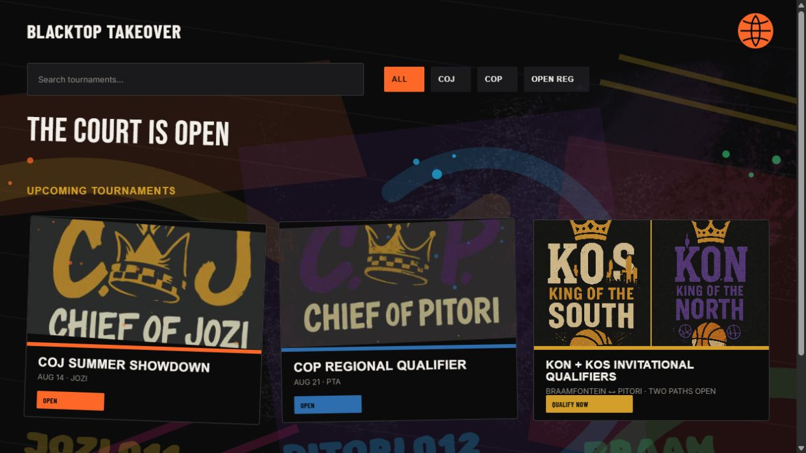
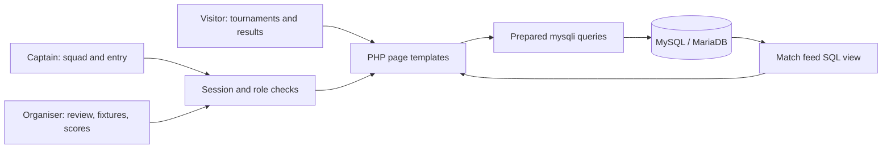

<p align="center"></p>

# Blacktop Takeover

**Gauteng streetball tournament platform · Integrated PHP/MySQL application**<br>
**Author:** Gedeon Kazadi · DV200, Semester 2

## Contents

- [About the project](#about-the-project)
- [Main functionality](#main-functionality)
- [Local setup](#local-setup)
- [Development process](#development-process)
- [Database implementation](#database-implementation)
- [Final outcome](#final-outcome)
- [Conclusion](#conclusion)
- [Credits and use terms](#credits-and-use-terms)

## About the project

Blacktop Takeover is a server-rendered PHP and MySQL application for organising Gauteng street basketball. It gives players and captains a route into competitive tournaments while giving organisers one place to review squads, publish fixtures, record results, and manage the climb from COJ and COP through KON or KOS to D.O.G.

The project solves a practical coordination problem: community tournaments often depend on scattered messages, manual team lists, and disconnected score updates. Blacktop Takeover joins registration, squad management, tournament entry, event administration, and public results in one database-driven system.

## Main functionality

- Player and captain registration with secure password hashing.
- Login sessions and role-based navigation.
- Captain squad creation, invitations, roster editing, activity status, jersey details, and vice-captain selection.
- Tournament discovery and database-driven tournament detail pages.
- Team entry applications with server-enforced registration deadlines and organiser approval or rejection.
- Organiser CRUD for tournaments and fixtures.
- Admin-only account role management.
- Result entry, tournament-specific basketball standings, and Match Centre feeds.
- Responsive PHP templates using semantic HTML, custom CSS, and vanilla JavaScript.



The screenshot shows the locally running interface. The SQL export supplies fictional demonstration accounts and tournament records.

## Technology

- PHP 8 with reusable includes and server-side sessions
- MySQL / MariaDB with foreign keys, joins, subqueries, indexes, and a reusable SQL view
- Semantic HTML5, custom CSS, and vanilla JavaScript
- XAMPP for the local Apache and MySQL environment
- No React, Tailwind, Node, or Express runtime is required

## Local setup

**Prerequisites:** Git, XAMPP with PHP 8 and MySQL/MariaDB, the `mysqli` extension and a browser. Apache serves the interface and PHP handlers together; there is no separate frontend build or Node backend.

Clone into the expected application subdirectory:

```bash
git clone https://github.com/GKaz17/blacktop-takeover-dv.git C:/xampp/htdocs/blacktop-takeover
```

1. Confirm the project is inside `C:\xampp\htdocs\blacktop-takeover`.
2. Start Apache and MySQL from the XAMPP Control Panel.
3. Open phpMyAdmin and import `database/blacktop_takeover.sql`.
4. Visit `http://localhost/blacktop-takeover/`.

The default connection in `config/connection.php` targets `localhost`, user `root`, an empty local password and database `blacktop_takeover_db`. The SQL import creates that database. Use these defaults only for the local development setup. Hosting requires your own restricted database account. The existing routes assume the `/blacktop-takeover/` subdirectory.

The default connection targets a standard XAMPP installation. The values can be overridden with the `DB_HOST`, `DB_USER`, `DB_PASSWORD`, and `DB_NAME` environment variables.

## Sanitised demonstration accounts

The SQL export includes fictional accounts and populated tournament data. Every demonstration account uses the password `BlacktopDemo26!`.

| Role | Email |
| --- | --- |
| Admin | `admin@blacktop.test` |
| Organiser | `organiser@blacktop.test` |
| Captain, Midrange Hoopers | `neo.mokoena@blacktop.test` |
| Captain, New Jamaica | `zinhle.daniels@blacktop.test` |
| Player | `kabelo.dlamini@blacktop.test` |

The `.test` addresses are reserved fictional data and do not identify real users.

## Competition rules

Completed group games award 2 classification points for a win and 1 point for a played loss. Basketball finals cannot be saved with a tied score; the organiser must record the score after overtime. Teams level on classification points are ordered by point difference, then total points scored, with the team name used only as a stable final display order.

Tournament applications close at the stored `registration_deadline` in the `Africa/Johannesburg` timezone. This rule is enforced by the PHP handler as well as reflected in the application controls, so a late request cannot bypass a disabled button.

## Development process

### Architecture and user flow



Reusable includes provide the navigation, page shell and competition helpers. A captain registers, builds an eligible squad and applies to a tournament. An organiser reviews the entry, creates a fixture and records its result. Visitors read the resulting public match feed. Admin-only role management is separate from captain/team ownership.

### Code decision: parameterised registration

From [`register.php`](register.php):

```php
$passwordHash = password_hash($password, PASSWORD_DEFAULT);
$userInsert = $conn->prepare(
    'INSERT INTO users (first_name, last_name, email, password_hash, role) VALUES (?, ?, ?, ?, ?)'
);
```

The registration handler hashes the password and binds values separately from SQL. Its transaction groups account and related squad operations so a failure can roll back instead of leaving a partially created registration. The full handler shows the binding, commit and rollback paths.

### Challenges and testing

| Challenge | Approach |
| --- | --- |
| Different users need different operations. | Session-backed role checks on PHP handlers as well as appropriate navigation. |
| Team and tournament data must remain related. | Foreign keys, prepared queries and eligibility checks against stored roster data. |
| Match pages could display inconsistent joined data. | A reusable SQL view assembles tournament and competing-team records. |
| Strong poster styling still needs usable forms. | Shared templates and responsive CSS carry the existing streetball identity into the application. |

PHP syntax can be checked from the project root with PowerShell and the XAMPP executable:

```powershell
Get-ChildItem -Recurse -Filter *.php | ForEach-Object {
    & C:\xampp\php\php.exe -l $_.FullName
}
```

For a manual workflow check, import the fictional seed data, sign in using each role, create or edit a squad, review a tournament entry, save a fixture result and reload Match Centre. An automated end-to-end suite is not included; this checklist is a reproducible verification route, not a claim that every interaction has just been retested.

## Database implementation

The export creates six related tables and the `tournament_match_feed` SQL view. The view joins tournaments, matches, and both competing team records so Match Centre can read one consistent result set. Dashboard summaries use scalar subqueries, while the remaining application queries use prepared statements and parameter binding.

The populated export includes:

- 12 fictional accounts across all four roles
- 2 complete five-player squads
- 3 tournament routes
- 4 confirmed tournament entries
- 2 completed fixtures with independent COJ and COP results

See the [ER diagram](docs/blacktop-takeover-erd.md) and [database implementation notes](docs/database-implementation.md) for the relationships and SQL evidence.

## Project structure

| Path | Purpose |
| --- | --- |
| `assets/` | Approved imagery, textures, CSS, and vanilla JavaScript |
| `config/` | Database connection configuration |
| `database/` | Importable schema, view, and sanitised seed data |
| `docs/` | ER diagram, design rationale, and database documentation |
| `includes/` | Shared header, footer, navigation, menu, and competition helpers |
| `admin.php` | Organiser and admin tournament operations |
| `team.php` | Player and captain squad operations |
| `match-centre.php` | Tournament fixtures, results, and standings |

## Design and proposal

The visual direction treats Blacktop Takeover as a Gauteng streetball movement rather than a generic sports dashboard. The interface uses the approved dark court palette, orange, yellow, blue, green and pink accents, condensed display typography, skyline artwork, and layered tar, paint, halftone, and broken-glass textures.

The implemented reference is documented in [design and project proposal](docs/design-and-project-proposal.md). Supporting visual assets are retained under `assets/images`.

## Final outcome

Public Google Drive URL: [Watch the Blacktop Takeover demonstration](https://drive.google.com/file/d/1RMcyg6h8CEVPHkOWKdMEi2zp-Qt5baTy/view?usp=sharing)

The project runs locally at [localhost/blacktop-takeover](http://localhost/blacktop-takeover/). No public deployment URL has been verified. The recording is shared publicly with link access, verified on 2 November 2026. Its runtime still needs to be checked against the required **5–8 minutes**.

## Security decisions

- Passwords are stored with `password_hash()` and checked with `password_verify()`.
- User-controlled SQL values are sent through prepared statements.
- State-changing forms use session-backed CSRF tokens.
- Organiser and admin routes verify session roles on the server.
- Output is escaped before rendering in HTML.
- The submitted database uses fictional accounts instead of personal data.

## Conclusion

Blacktop Takeover joins the public tournament experience to the organiser and captain workflows in one relational application. The main achievement is connecting squad eligibility, entry review and result publication while preserving a recognisable Gauteng streetball identity.

Next steps include broader automated workflow tests, bracket generation, venue check-in, notifications and player statistics. These are future improvements, not current features.

## Credits and use terms

- **Author and contact:** [Gedeon Kazadi](https://github.com/GKaz17) · [21100471@virtualwindow.co.za](mailto:21100471@virtualwindow.co.za)
- **Course and design:** Open Window DV200. The existing course Figma direction and exported/adapted artwork are described in [design and project proposal](docs/design-and-project-proposal.md). Source-artwork creators and any externally supplied posters still need their original attribution confirmed; no exclusive ownership is claimed for those resources.
- **Runtime and documentation:** [PHP](https://www.php.net/), [MySQL](https://www.mysql.com/), [MariaDB](https://mariadb.org/) and [XAMPP](https://www.apachefriends.org/).
- **Fonts:** Inter, Bebas Neue, Barlow Condensed and Rubik Spray Paint, loaded through Google Fonts; their respective font licences apply.
- **Assets:** Existing skyline artwork, textures, posters and basketball navigation mark are retained under `assets/images`; their design context is documented in the proposal.
- **AI assistance:** ChatGPT and Codex supported research into unfamiliar technical approaches, implementation, debugging and documentation.
- **Use terms:** Academic and portfolio project. No repository-wide open-source licence has been granted. Third-party fonts, artwork and other resources retain their original rights.
